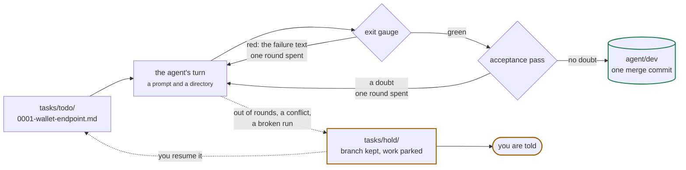
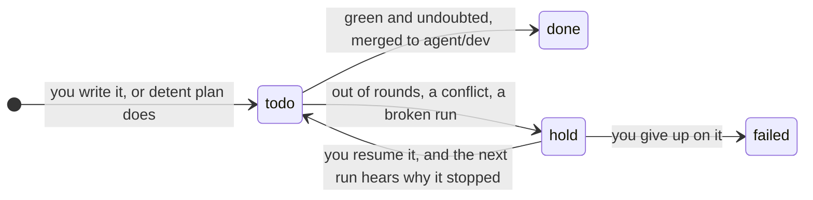
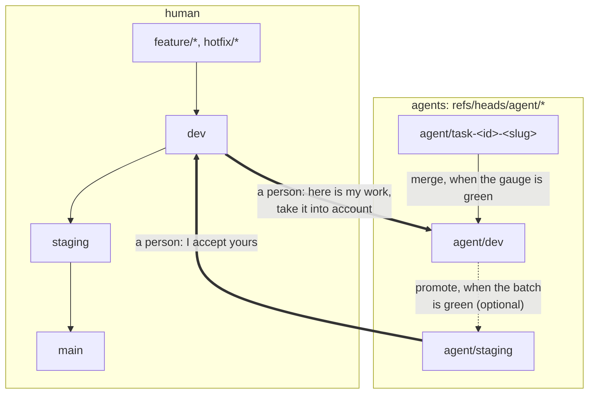

# detent

[](https://www.npmjs.com/package/@kazimvakhobov/detent)
[](https://detent.kazimvakhobov.com/)
[](https://github.com/kazimVakhobov/detent/actions/workflows/verify.yml)


[](LICENSE)

**Run coding agents against a queue of tasks, and let nothing finish until your
own checks pass.**

detent dispatches Claude Code at one task per repository at a time, holds each
behind that repository's own gauge on the way out, has a second model read every
green diff, merges what survives into a branch of its own — and writes down what
each run cost in attempts, time and money.

The constraints are in the code, not in the prompt.

> A detent is the catch that holds a mechanism in a defined position until it is
> deliberately released. Here it is released by a green gauge, and by nothing
> else.

```
npm i -g @kazimvakhobov/detent
```

Node 22, macOS or Linux, and Claude Code installed and signed in. detent drives
the agent you already pay for and ships none of its own. Zero dependencies.

**[detent.kazimvakhobov.com](https://detent.kazimvakhobov.com/)** is the site,
and **[the dashboard is live on it](https://detent.kazimvakhobov.com/demo/)** —
the real `detent dashboard`, built from this version's code against a made-up
product, with a task running in it. Nothing on it is a mockup: the answers are
the real server's, taken when the site was built.

## The three claims

**When is the agent allowed to stop?** Not when it says it is done — when the
project's checks pass. The gauge runs on the agent's way out; red means it does
not get to leave, and it is handed the failure text to work from.

**Was it worth it?** Every run is a line in a journal: which model, how many
rounds it took, which stage it died on, how long, how much. That turns "which
model should run this repository" from an opinion into a number.

**Who says it is done?** A second model reads the diff against the task's
acceptance criteria, and it may **demote, never approve**. Green is granted by
machine checks. A model's judgement can only raise a doubt — which costs the
agent another round, and on the last one sends the task to a person. Otherwise
"proven" quietly becomes "a second model agreed".

## It builds itself, and here are its numbers

Since 2026-10-13 the tasks in this repository have been dispatched by
`detent run`, held behind the gauge, read by the acceptance pass and merged by
the tool. `git log --grep='^Acceptance: '` is the record, and nobody typed those
trailers by hand. Where that is not true the commit says so itself: the tasks
after 0.9.0 were worked in a session and merged by hand, and each says as much
in place of the `Gauge:` and `Acceptance:` trailers it does not carry.

| From this repository's own journal | |
|---|---|
| Runs recorded | 39 |
| Pass rate | 72% |
| Cost per task that landed | $10.52 |
| Green runs the reviewer read | 36 |
| …of those, demoted | 22% |

That last row is the number the product exists to produce: **almost a quarter of
the runs whose machine checks were green had not actually done the task.** Every
one of those was a person's hour that a passing test suite would have told
nobody about.

The task files are still written by a person, and so is everything past
`agent/dev`: the pull request, the tag, the release.

## How a run goes

A task is a markdown file. The frontmatter is bookkeeping; **only the body
reaches the agent** — the spec written before the work is the prompt.

```markdown
---
id: 0001                 # the order tasks run in, and the file name
repo: acme-api           # which repository in product.json it is in
touches_contract: false  # true makes it a barrier: it runs alone, and
                         # no higher number starts until it has passed
---

# Goal

One paragraph: what must work when this is done.

# Acceptance criteria

- [ ] a checkable statement

# Out of scope

What not to do while you are in there.
```

Save it as `tasks/todo/0001-wallet-endpoint.md` and run `detent run`. Then, for
up to `attempts` rounds (default three), each call to a model bounded by
`timeout` minutes (default thirty):



1. **the agent's turn** — a prompt and a working directory, and nothing else
2. **the exit gauge** — the repository's own checks. Red hands back the failure
   text and costs one round
3. **the acceptance pass** — a second model reads the diff. A doubt hands back
   the doubt and costs one round, the same budget the gauge spends

**One task at a time, unless you say otherwise.** `concurrency` is 1 in
`product.json`; raise it and tasks run side by side — but never two in the same
repository, because they would be two agents in one working copy, and more
slots than you have repositories is refused as a number that cannot be reached.
**`touches_contract: true` makes a task a barrier:** the pool drains, it runs
alone, and nothing with a higher number starts until it has passed, because a
task queued behind a contract change must not begin against the contract that
change is about to replace. The id and that one flag are the only ordering
detent knows; it infers no dependency from anything else
([DESIGN.md §8](DESIGN.md#8-scheduling)).

Green and undoubted, the task lands on `agent/dev` as one merge commit carrying
what it cost. Out of rounds, or a conflict, or a broken run, and the task moves
to `tasks/hold/` with its branch kept and the work parked on it — and you are
told, through whatever channel you configured.

**A resume is a decision, not a `mv`.** The next `detent run` reads `hold/`
before it starts anything and offers three answers for each task it finds
there: leave it, resume it now, or open `plan` to amend the criteria that were
wrong — which is very often what a rejected task actually needs. A bare Enter
leaves it, because nothing a person did not answer should start a run that
costs money. detent then carries the file back itself, and the next run hands
the agent what stopped the last one. Moving the file by hand still works and
means the same thing. **And a paused barrier goes on barring** — the rule above
holds across runs and not only inside one, which is a correctness rule rather
than a question, so it holds in a script and a cron line exactly as it does in
a terminal. `detent run --past <id>` is how you say that contract landed
another way
([ADR 0024](docs/adr/0024-a-barrier-bars-until-it-passes-and-a-resume-is-a-decision-not-a-move.md)).

Nothing has touched a branch of yours.

## Where a task file goes

The queue is four folders, and the folder a file is in is the task's state.
detent moves a file out of `todo/`, and back into it when you resume one;
`failed/` is the person's alone, and detent never moves a task there.



## The line agents do not cross



detent reads and writes refs under `refs/heads/agent/` and nothing else — one
namespace, one predicate, one glob to audit it with. Both gates between the
territories are human operations, in both directions. It refuses to start on a
dirty tree, and never moves a ref outside its own namespace.

**What it pushes is the queue, and only the queue.** Nothing in a repository of
your product is ever pushed — not `agent/dev`, not a tag. A queue that lives in
a repository of its own is the exception, because that queue is detent's own
bookkeeping and the next machine has to read it as it is now
([ADR 0012](docs/adr/0012-the-queue-and-the-shared-context-may-be-repositories.md)).

`agent/staging` is optional and exists for one reason: the per-task gauge checks
a task, and what actually breaks is the combination. The batch gauge runs there,
and how often a batch came out red after every task in it was green is a number
detent reports.

## Setting up a product

**A product folder is not the folder your repositories happen to sit in.**
detent treats everything directly inside it as one product, so give it a folder
of its own:

```
~/work/acme/
  .detent/product.json      written by init
  tasks/{todo,hold,done,failed}/
  acme-api/                 a full clone, on any branch
  acme-web/
```

Then, from that folder:

```
git -C acme-api branch agent/dev dev    # the integration branch
detent init                             # scan, then ask what a scan cannot see
detent doctor                           # the nine conditions, and what to change
```

`init` asks you the two things no scan can settle — which repository holds the
queue, and which holds the documents your tasks link to. They are the only
questions it asks; `--queue` and `--docs` answer them from the command line, and
with no terminal on stdin the defaults are taken and printed, so `init` in a
script never waits.

**The documents are mounted, not fetched.** An agent is given a prompt and a
working directory and nothing else
([ADR 0013](docs/adr/0013-the-agent-gets-a-prompt-and-a-directory.md)), so what
it has to read has to be in the tree it was handed: the documents, and a kit
beside them if the product has one, arrive as submodules. Every tracked one is
brought to its remote's tip before the first turn, so a task is worked against
one revision of the context; that revision goes into the commit and the
journal; and a submodule sitting at a commit no remote branch contains pauses
the task by name rather than recording a pointer nobody can look up
([ADR 0012](docs/adr/0012-the-queue-and-the-shared-context-may-be-repositories.md)).
A task links to a document by path — `shared-docs/adr/0003.md` in a task for
`acme-api` — and a broken link is told to the agent, recorded and shown to the
reviewer, but never stops the run: detent cannot tell a load-bearing link from
a decorative one
([ADR 0014](docs/adr/0014-init-asks-where-the-queue-and-the-documents-are.md)).
The methodology that comes from is written up in
[Agents need context, not access](https://kazimvakhobov.com/agents-need-context-not-access/).

Read the two things it cannot decide for you before an agent is held to them:

- **the gauge.** Stages are proposed only from scripts a repository declares, so
  what you get is what the repository advertises, not what you would have
  chosen. `detent gauge` runs them by hand, and `doctor` says when a repository
  declares a check the gauge does not run.
- **`models.accept`.** Left empty, there is no acceptance pass at all, and
  `init` leaves it empty: it must name a different model from `implement`.
  Which models your account can run is not something a scan can see, so the line
  is yours to write
  ([ADR 0019](docs/adr/0019-the-offered-model-names-are-a-suggestion-in-the-product-file.md)).

**And one thing you do not have to decide at all.** A product that configures
nothing still reaches you: the desktop notifier, when a task pauses and on no
other occasion. `notify` is either a shell command — run with the
message on its stdin and the details in its environment — or
`{ events, channels }`, where the events are the three occasions (`paused`,
`passed`, `promoted`) and the five outcomes you can ask for on their own
(`escalated`, `rejected`, `error`, `red`, `stale`), and a channel is one of the
two kinds there are: `command` and `telegram`. A third is added when it has
delivered a real message, not when its module compiles — the rule
[0018](docs/adr/0018-one-agent-in-the-first-version-and-what-readmits-another.md)
put on agents, carried across.

**A channel names its secret and never holds it.** `product.json` says which
environment variable the token is in, and detent reads it when it sends — the
environment first, then `.detent/secrets.json`, created `0600` and gitignored
by `init`. A token in `product.json` would be a token in a page, because the
dashboard serves that file to a browser, and sooner or later a token in a
commit; the dashboard is also where a channel and its token can be set without
you editing either file. One channel failing is not the run failing — a task
that paused is already a task you need to hear about. Each is attempted once,
with no retry and no queue, because detent is not a notification router; each
reports for itself; and nothing that comes back from one can carry the token
([ADR 0025](docs/adr/0025-a-channel-is-a-kind-and-the-secret-is-not-in-the-configuration.md)).

## The commands

| | |
|---|---|
| `detent doctor` | whether this product is in the shape detent expects |
| `detent init` | scan the workspace and write `product.json` |
| `detent plan` | discuss a task with an agent; it writes the task files |
| `detent run` | work the queue |
| `detent promote` | merge `agent/dev` into `agent/staging` behind the batch gauge |
| `detent summary` | pass rate, attempts per run, cost per pass |
| `detent dashboard` | a page that watches this product |
| `detent gauge` | run a repository's gauge by hand |
| `detent recover` | return repositories an interrupted run left behind |
| `detent prune` | delete `agent/task-*` branches already merged into `agent/dev` |

Every command in `detent --help` does something.

The dashboard watches a run while it happens — what the agent is saying as it
says it, what each round of each task did and what it cost, and the
configuration, which it will write back between runs. It serves
`http://127.0.0.1:4100` and nothing else (`--port` moves it), the page loads
nothing from anywhere else, and a write has to come from the page it served:
binding localhost stopped meaning anything the moment that page could save a
configuration, since any site open in the same browser can post to a port on
it.

## This product is opinionated

It expects a product shaped a particular way, and says so instead of adapting
to everything:

1. git, not a shallow clone
2. the product's repositories sit side by side in one folder — one per unit of ownership
3. each repository names one human branch to be compared against (any name) — a
   release train behind it is not detent's business
4. the gauge is declared as stages: a name and a command, runnable locally
5. a clean tree when a run starts
6. an agent CLI installed and authenticated — Claude Code, the only one offered
   in this version ([0018](docs/adr/0018-one-agent-in-the-first-version-and-what-readmits-another.md))
7. the integration branch is not deployed; pushing is done by hand
8. one person per workspace
9. macOS or Linux, Node 22

`detent doctor` checks all nine and tells you what to change.

## Status

**Status: 1.0.0 — all thirteen build steps are done, and the queue of a
shipped product that is not this one has been worked by the tool.** Those were
the two conditions, and every command listed above works.

**[Yuk Markaz 24](https://yukmarkaz24.uz) is the product that settled it.** A
freight marketplace in production — seven repositories, a NestJS API every
browser and mobile client is built against, the prose documents mounted into
the code repositories as a submodule, and the queue in a repository of its own.
On 2026-10-21 and 2026-10-23 its queue was dispatched by `detent run`: eleven
tasks, thirteen runs across three of the seven, **85% of them passed, at $7.64
for a task that landed.** Of the twelve runs whose machine checks came out
green the reviewer refused one outright; twice more a doubt cost a round that
the next round then answered. One task spent all three attempts and stopped on
a merge conflict in the OpenAPI contract, was parked on its branch, and passed
when it was resumed two days later. That is the whole mechanism — the gauge,
the acceptance pass, the hold, the resume — exercised by a product that knows
nothing about detent, and none of those numbers come from this repository.

**[QMed](https://qmed.uz) is the second one, set up and queued.** A clinic
platform, also in production and also seven repositories: `detent init` scanned
it, recorded the six submodule edges a scan can see and six contract edges the
model pass proposed on top of them, and twelve tasks are written and waiting in
its `todo/`. No run has been dispatched there yet, so it is here for the one
thing it proves — that `init` reads a product it was not built around — and for
nothing more.

[PROGRESS.md](PROGRESS.md) says where the build is, and what the versions mean.

## Where to read more

- [DESIGN.md](DESIGN.md) — the specification the code is written against: the
  branch boundary and the invariant that guards it, the task lifecycle with
  every outcome it can have, the shape of `product.json` and of a journal line,
  and what is deliberately left out. Written before the code, which is also how
  detent expects tasks to be written.
- [docs/adr/](docs/adr/) — twenty-six decisions, each with what it rejected and
  what that cost
- [CONTRIBUTING.md](CONTRIBUTING.md) — branches, commit format, how a release is
  cut
- [PROGRESS.md](PROGRESS.md) — where the build actually is
- [CHANGELOG.md](CHANGELOG.md)

## License

MIT
